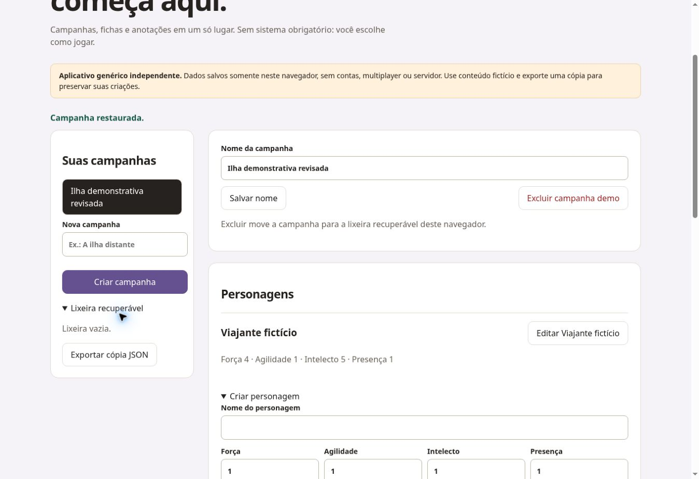

# Grimorio RPG

Gerenciador genérico independente para RPG de mesa, sem regras obrigatórias ou integração com sistemas comerciais. Interface em português, responsiva, sem bibliotecas externas.

## Funcionalidades

Criar, renomear e excluir campanhas para lixeira recuperável; restaurar campanha; criar e editar personagens com quatro atributos genéricos; inventário por personagem; notas por campanha; rolagens de d4, d6, d8, d10, d12 e d20, com quantidade e modificador; histórico de rolagens; exportação de cópia JSON. Persistência em localStorage.

## Executar e testar

`python3 -m http.server 8000`, depois http://localhost:8000. Testes: `node --test core.test.mjs` — 4 testes aprovados. No navegador da prévia técnica em 30/10/2026: criação e renomeação de campanha, personagem e atributos, rejeição de atributo 21, inventário com quantidade 2, notas e recuperação após recarga. Rolagem 2d6 +3 retornou dados 6 e 3, total 12; exclusão para lixeira e restauração verificadas.

## Limitações

Sem multiplayer, contas, nuvem, backend, sistema de combate ou importação de backup. Dados apenas neste navegador; limpar dados do site remove registros e lixeira. A exportação JSON pode conter conteúdo escrito pelo visitante: guarde com cuidado. Uma cópia exportada não pode ser reimportada pela interface nesta versão. Atributos usam limites genéricos de 0 a 20. Não há API paga ou serviços externos.

## Publicação

Demonstração pública: https://matheuz-code.github.io/grimorio-rpg/ — validada em 30/10/2026: campanha, personagem, atributo inválido, inventário, notas, persistência, dados e lixeira com restauração.

## Captura da prévia técnica

